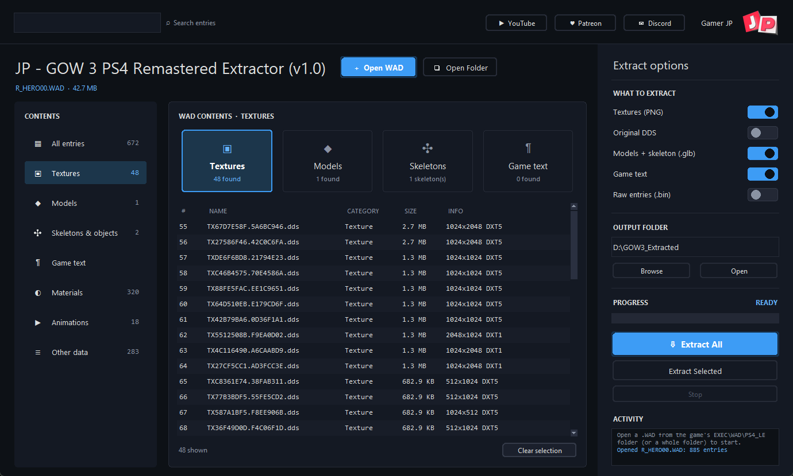

# JP - GOW 3 PS4 Remastered Extractor

**A free Windows tool that extracts models, skeletons, textures and text from *God of War III Remastered* (PS4) WAD files.**
Open a `.WAD`, browse what's inside, and export textures as PNG and characters as `.glb` with their **real game skeleton and skin weights**, ready for Blender.

> Made by **Gamer JP**. Free to use – a credit is always appreciated.

[](https://www.youtube.com/@jpthehero)
[](https://www.patreon.com/c/gamerjp)
[](https://discord.gg/uBTutBA8VX)



---

## Features

- **Textures → PNG** (optionally the original **DDS** too). Supports every format in the game: DXT1, DXT5, cube maps, 8-bit and 32-bit.
- **Models → `.glb` (glTF 2.0)** with the **game's own skeleton** and **skin weights**. Characters bend correctly when you pose them in Blender.
  - Kratos (all 9 outfits), Zeus, Hades, Athena, enemies and more are skinned to their real skeletons.
  - Rigid parts (armour, helmets, beards, eyes) are attached to their joint and placed on the body.
  - Weapons, props and level pieces are exported as static meshes.
- **Skeletons → JSON** (joint names, parents, positions).
- **Game text** (`MSGS_TXT` from `R_LANG_*.WAD`) → `.txt`.
- **Raw entries** → `.bin` for your own research.
- Browse a WAD before extracting: category filters, search, multi-select, **Extract Selected** or **Extract All**.
- **Batch mode**: open a whole folder and extract every WAD in it.
- Single `.exe` – nothing to install, no Python needed.

## Requirements

| | |
|---|---|
| OS | Windows 10 / 11 (64-bit) |
| Game files | God of War III Remastered, PS4 **CUSA01715** (tested on v1.02). Other regions should work. |
| Viewer for models | Blender 3.6 or newer (File → Import → glTF 2.0), or any glTF viewer |

You need **your own copy of the game** (the extracted PS4 game folder). This tool contains **no game data**.

## Download

1. Go to the [**Releases**](../../releases) page.
2. Download **`JPGow3_Extractor_v1.0.zip`** and unzip it anywhere.
3. Run **`JPGow3 Extractor.exe`**.

> **Windows SmartScreen / antivirus:** the program isn't code-signed, so Windows may show *"Windows protected your PC"* – click **More info → Run anyway**. Some antivirus tools flag packaged Python programs by mistake (false positive). Only download it from this page.

## How to use

1. Click **+ Open WAD** and pick a file from your game folder: `…\CUSA01715\EXEC\WAD\PS4_LE\`
   (or **Open Folder** to process many WADs at once).
2. On the right, switch on what you want: **Textures (PNG)**, **Original DDS**, **Models + skeleton (.glb)**, **Game text**, **Raw entries**.
3. Pick an **Output folder**.
4. Click **Extract All** – or select entries in the list (Ctrl / Shift-click, use the categories and search) and click **Extract Selected**.

Output: `<Output folder>\<WAD name>\textures`, `models`, `skeletons`, `text`, `raw`.

### Useful WADs

| File | Contents |
|---|---|
| `R_HERO00.WAD` | Kratos (default outfit) – `R_HERO01…08` are the other costumes |
| `R_W_EXPLOSIVE0…4.WAD` | Blades of Exile (one file per upgrade level) |
| `R_W_EXPLOSIVE5.WAD` | Blades of Athena (+ Blade of Olympus copy) |
| `R_W_GODMODE0…4.WAD` | Blade of Olympus |
| `R_ZEUS00.WAD`, `R_HADES.WAD`, `R_ATHENA00.WAD`, … | Bosses and characters |
| `R_LANG_EN.WAD` (and other languages) | Game text |

### Command line

```
"JPGow3 Extractor.exe" --cli <file.WAD or folder> <output folder>
```

## Tips & known limits

- **Textures are not linked to the models yet.** Every model has named material slots (`material_00`, `material_01`, …); assign the extracted PNGs yourself.
- The default Kratos model contains the **Hermes' Boots** (hidden in game until you earn them) – delete them in Blender if you don't need them.
- A few rigid armour pieces can sit a few centimetres off the body in the rest pose.
- Level geometry is exported piece by piece in its own space (not assembled into the level layout).
- Cube maps are saved as the 6 faces side by side.

## Troubleshooting

| Problem | Fix |
|---|---|
| Windows blocks the program | **More info → Run anyway** (the exe isn't code-signed). |
| Antivirus removes the exe | False positive of the packager – restore it / add an exception, or don't use it. |
| A model looks invisible from some angles in Blender | Turn off *Backface Culling* or recalculate normals; the game uses one-sided faces. |
| "Could not read …" | The file isn't a God of War III PS4 WAD (or it's damaged). |

## Credits

- **Gamer JP** – author ([YouTube](https://www.youtube.com/@jpthehero) · [Patreon](https://www.patreon.com/c/gamerjp) · [Discord](https://discord.gg/uBTutBA8VX))
- Santa Monica Studio / Sony Interactive Entertainment – *God of War III*

## Disclaimer

This is a fan-made tool, not affiliated with or endorsed by Sony Interactive Entertainment or Santa Monica Studio.
*God of War* is a trademark of Sony Interactive Entertainment LLC. The tool contains no game data; extracted assets belong to their owners – use them for personal modding and research only.

## License

See [LICENSE.txt](LICENSE.txt). Free to use; please don't re-upload or sell the tool, and credit **Gamer JP** when you share work made with it.
